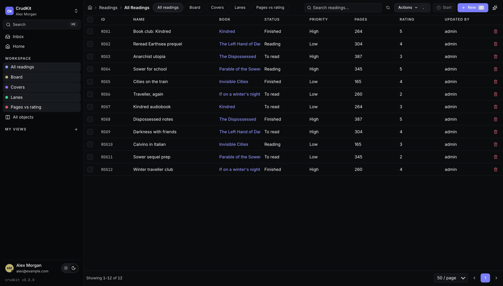
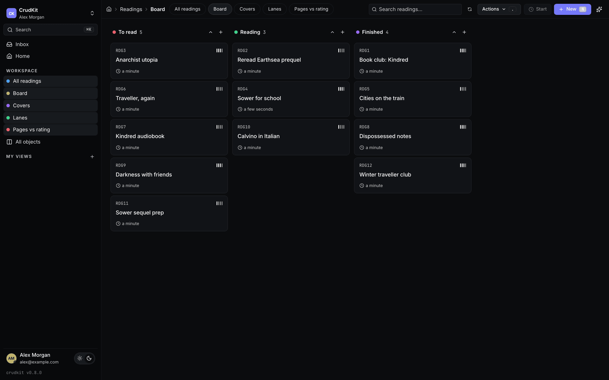
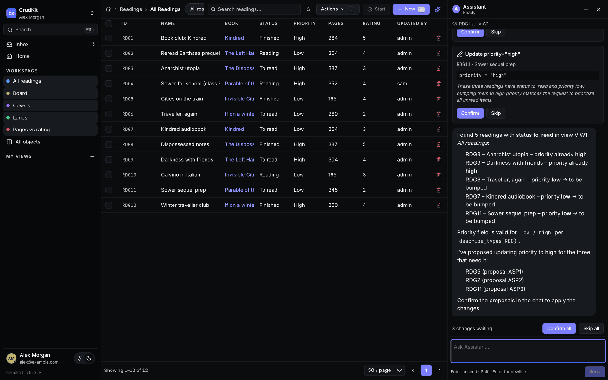
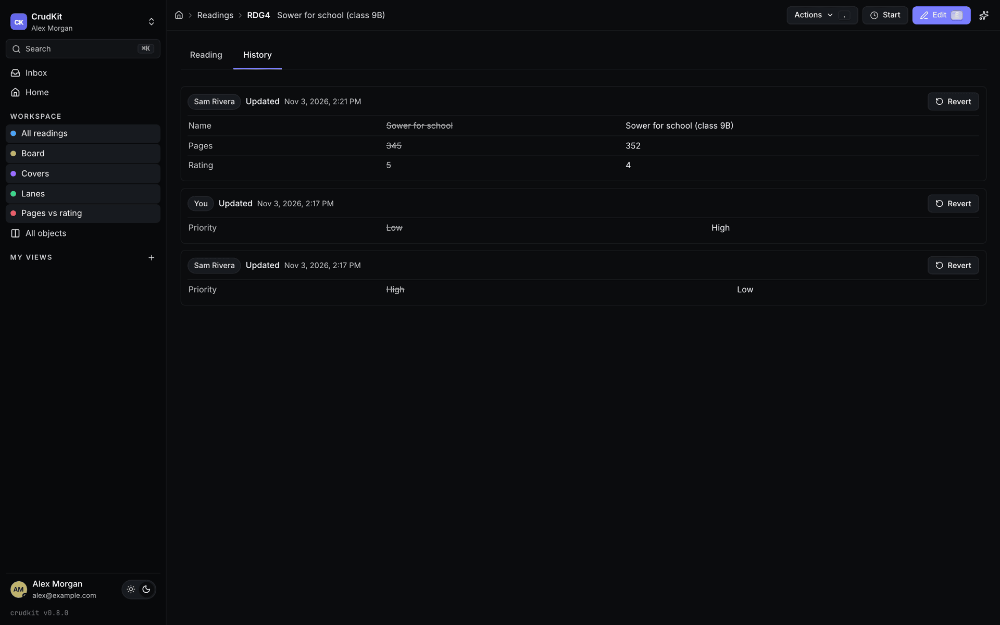
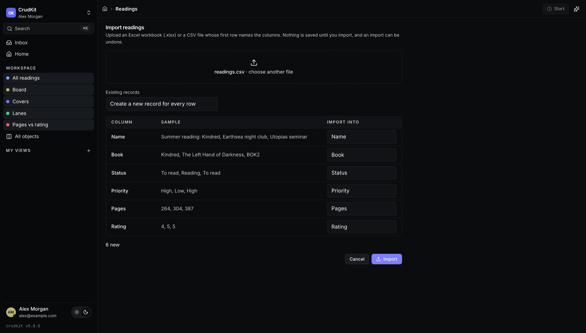

<p align="center">
  
</p>

<h1 align="center">CrudKit</h1>

<p align="center">
  <strong>Turn Django models into a complete, AI-ready business app.</strong>
</p>

<p align="center">
  <a href="https://pypi.org/project/crudkit/"></a>
  
  <a href="LICENSE"></a>
</p>

Give a Django model a three-letter `TYPE_ID` and CrudKit builds the rest: a REST API, a fast
web UI with lists, boards and record pages, saved views, history with undo, spreadsheet import,
bulk edits, an AI assistant and an MCP server for AI clients. You don't write serializers,
viewsets, routes or frontend code for any model. The built UI ships inside the Python wheel,
so you don't need Node either.



## From model to app

```python
from django.db import models
from crudkit.decorators import crm_action
from crudkit.fields import AICategoryField, AISummaryField
from crudkit.models import BaseCrudKitModel


class Ticket(BaseCrudKitModel):
    TYPE_ID = "TIC"

    subject = models.CharField(max_length=255)
    customer = models.ForeignKey("Customer", on_delete=models.CASCADE)
    status = models.CharField(max_length=16, choices=[("open", "Open"), ("closed", "Closed")])
    summary = AISummaryField(prompt="Two-sentence summary of the ticket.")
    category = AICategoryField(prompt="The kind of request.", choices=[("bug", "Bug"), ("billing", "Billing")])

    @crm_action("Close ticket")
    def close(self, request):
        self.status = "closed"
        self.save()

    class CrudKitSettings(BaseCrudKitModel.CrudKitSettings):
        search_fields = ["subject", "customer__name"]
```

That model now has:

- an ID like `TIC42` that works everywhere: in the URL `/TIC42`, in search, in links between records and in AI tool calls
- `GET/POST/PATCH/DELETE /api/v1/TIC/` plus a `/metadata/` endpoint that describes its fields and actions
- list, board, create, edit and detail pages, with pickers for related records and a "Close ticket" button
- created/updated by and at, soft delete with restore, merge for duplicates, a change log and an activity feed
- a summary and category that an LLM fills in after each save
- a place in global search, the assistant and the MCP server, checked against the user's permissions

## Features

**Data model**
- Typed record IDs (`CUS42`) that address any record from just its ID
- Audit columns, soft delete and restore, merge that moves every related row to the record you keep
- Change log and activity feed on every record: notes, plus the kinds of entries you declare (calls, meetings, emails)
- External IDs for syncing with other systems, money and currency fields with exchange rates, time tracking

**Web UI**
- Lists, forms and record pages generated from metadata, with nothing to configure per model
- Saved views as a **table, kanban, gallery, quadrant or swimlane**, with a visual filter builder and live counts in the menu
- Layouts with related lists on record pages, and workspaces that group views into apps
- ⌘K command palette that searches across every type, and "Create new…" straight from a picker
- Live updates over WebSocket: lists and records refresh when someone else changes them
- Light and dark themes, plus your own app name, logo and brand colour

**Working with lots of records**
- Bulk edit, delete or run an action on a selection, applied as one change set
- **Import from Excel or CSV**: map the columns, preview every row, update matching records or create new ones
- Progress bars for long-running actions, including ones handed off to Celery
- A full history on every record and **one-click undo** of any change set: a save, a bulk edit, an import or an AI change

**AI built in**
- An **assistant sidebar** (⌘J) that sees what's on screen, reads across record types, and proposes changes for you to confirm
- It also fills in forms and drafts bulk changes, and you check them before saving
- **AI fields**: summaries, categories, yes/no answers, tags and links to other records, filled in the background
- **AI context**: documents your team writes (ideal customer, tone of voice, playbooks) that every AI feature reads
- **Background agents**: saved instructions that run when a record changes, on a schedule or on demand, with dry runs and "revert this run"
- **Approvals**: mark the actions and fields that need a person's sign-off; AI clients can only propose those changes, which wait in an Inbox
- Works with any [pydantic-ai](https://ai.pydantic.dev) model, hosted or local (llama.cpp, Ollama, vLLM, …)

**Integrations**
- One generic REST API with JWT auth for every model
- A remote **MCP server** with OAuth 2.1, so you can add your app to Claude or any MCP client as a connector. On the consent screen, users choose *read only*, *propose changes* or *write directly*
- Celery for AI fields, agents and long tasks; Channels for real-time updates

**Safe by default**
- Standard Django model permissions on every API call, assistant step and MCP tool, with hooks for row-level rules
- Approval rules for AI and MCP writes, per-token rate limits, and every change records who made it and through which client

<table>
  <tr>
    <td width="50%"><br><sub><b>Boards</b>: drag cards between columns; the order is saved</sub></td>
    <td width="50%"><br><sub><b>Assistant</b>: proposes changes, and you confirm them</sub></td>
  </tr>
  <tr>
    <td width="50%"><br><sub><b>History</b>: who changed what, with one-click revert</sub></td>
    <td width="50%"><br><sub><b>Import</b>: map columns and preview before anything is saved</sub></td>
  </tr>
</table>

## Use cases

- **CRM and sales pipelines**: companies, people, deals and activities, with boards per stage, an assistant that drafts follow-ups, and agents that flag at-risk accounts every Monday.
- **Back-office and operations tools**: orders, support cases, contracts and approvals. Your team gets search, bulk edits and an audit trail without anyone building admin screens.
- **Registers and inventories**: assets, vendors, licences, equipment. Import the spreadsheet you have today and keep the views, history and permissions.
- **Replacing shared spreadsheets**: import, create saved views for each team, and edit in bulk. Every change has a name next to it and can be undone.
- **A data layer for AI agents**: connect Claude or another MCP client to your business data, with each user's own permissions, and approvals for anything risky.
- **Prototyping data-heavy products**: start with models and get a usable app on day one. Add custom actions, dashboards and tools as the product grows.

## Quickstart

```bash
pip install "crudkit[api,assistant,mcp]"
```

```python
# settings.py
INSTALLED_APPS = [..., "rest_framework", "crudkit", "crudkit_frontend"]

REST_FRAMEWORK = {
    "DEFAULT_PERMISSION_CLASSES": ["crudkit_api.permissions.CrudKitModelPermissions"],
    "DEFAULT_PAGINATION_CLASS": "crudkit_api.pagination.CrudKitPagination",
    "DEFAULT_FILTER_BACKENDS": ["crudkit_api.filters.BasicFilter"],
    "PAGE_SIZE": 50,
}
TEMPLATES[0]["OPTIONS"]["context_processors"] += ["crudkit_frontend.context_processors.crudkit_config"]
CRUDKIT_FRONTEND_CONFIG = {"app_name": "My App"}

# urls.py
urlpatterns = [
    path("api/v1/", include("crudkit_api.urls")),
    path("", include("crudkit_frontend.urls")),  # the web UI; must be the last pattern
]
```

The assistant, live updates and the MCP server each need a few more lines (an ASGI router,
Celery, OAuth URLs). [backend/README.md](backend/README.md) covers them step by step.

### Try the demo

The demo is a small reading-list app with authors, books and readings, plus a saved view for every layout:

```bash
cd frontend && npm ci && npm run build        # build the bundled UI once
cd ../examples/demo
uv sync && uv run manage.py migrate && uv run manage.py seed
uv run manage.py runserver                    # http://localhost:8000, admin / admin
```

Set `DEMO_AI_MODEL` (for example `anthropic:claude-sonnet-5`, or a local OpenAI-compatible
server) to try the assistant. See [examples/demo/README.md](examples/demo/README.md).

## How it works

CrudKit is a set of Django apps:

| App | What it does |
|---|---|
| `crudkit` | `BaseCrudKitModel`, typed IDs, change log, feed, saved views, AI fields, jobs |
| `crudkit_api` | Generic REST API, metadata endpoint, history and undo, bulk changes, import |
| `crudkit_assistant` | Assistant sidebar, proposals, AI context, background agents |
| `crudkit_mcp` | Remote MCP server with its own OAuth 2.1 provider |
| `crudkit_frontend` | Serves the bundled React UI, which renders from the metadata endpoint |

The web UI never hard-codes a model. It asks the API what fields, actions and views a type has
and renders them. So a new model, field or `@crm_action` shows up in the UI, the API, the
assistant and MCP as soon as you add it.

## Documentation

- [Concepts](docs/concepts.md): typed IDs, settings, saved views, history and undo, import, approvals, agents
- [Backend reference](backend/README.md): installation, every setting, the MCP server, agents
- [Demo project](examples/demo/README.md): a complete consumer project, used in CI
- [Behaviour spec](backend/tests/bdd/README.md): every public behaviour as plain-language scenarios
- [Changelog](backend/CHANGELOG.md)

## Contributing

Pull requests are welcome. [CONTRIBUTING.md](CONTRIBUTING.md) explains the development setup,
the tests and the behaviour-spec workflow.

## License

[MIT](LICENSE)
